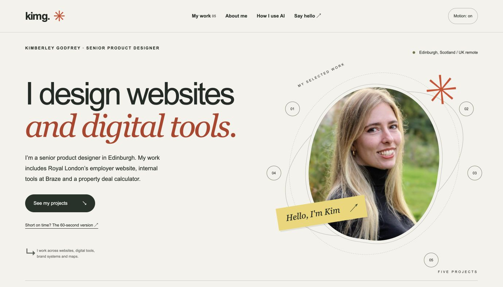
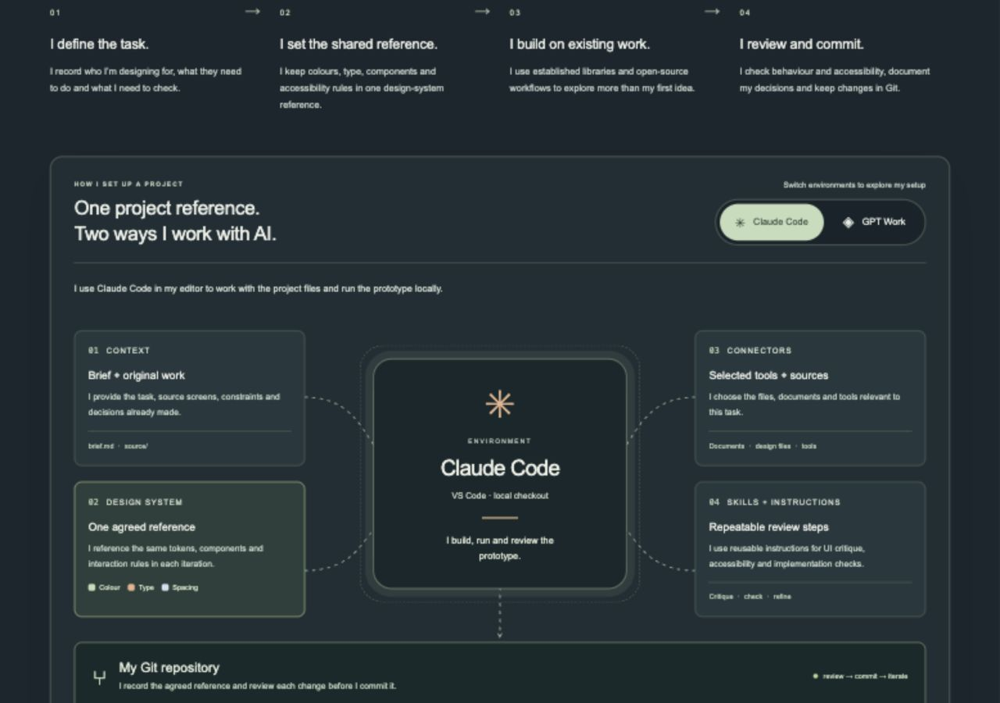

# Kimberley Godfrey · UI and experience design portfolio

[](https://github.com/Warfuse/kimberley-godfrey-portfolio/actions/workflows/ci.yml)

**I design websites and digital tools, from research and navigation through to interfaces and delivery.** This repository shows my selected work, the decisions behind it and interactive previews built for this portfolio.

[Explore my portfolio](https://amaplan.com/) · [Try my independent Hilo concept](https://amaplan.com/hilo/) · [Download my CV](https://amaplan.com/assets/Kimberley-Godfrey-CV.pdf)



## Start here

If you are reviewing my work, the live portfolio is the quickest route. In this repo:

- **[My project brief](docs/brief.md)** — audience, tasks and scope.
- **[My design approach](docs/design-approach.md)** — how I use context, a shared design system, AI tools and review.
- **[Case-study evidence](docs/case-studies.md)** — what I did and what each preview demonstrates.
- **[Design-system reference](docs/design-system/README.md)** — visual tokens, components and interaction rules.
- **[Architecture](docs/architecture.md)** and **[security](SECURITY.md)** — how the optional AI service works.

## My selected work

| Project                   | My contribution                                                         | What you can explore                                                                                                                |
| ------------------------- | ----------------------------------------------------------------------- | ----------------------------------------------------------------------------------------------------------------------------------- |
| Royal London              | Employer website UX and navigation                                      | Archived original screens linked into a task-led replay. Website launched in 2024.                                                  |
| Braze                     | Knowledge-space pages, ROI interface and sales materials                | Original-screen navigation, editable ROI layout and full-resolution exports. Proprietary calculations are unavailable.              |
| Express Capital Financing | Guided fix-and-flip calculator concept                                  | A working illustrative calculator with scenarios and cost breakdowns. Pitched concept, not shipped.                                 |
| Fuse Growth Studio        | Logo and brand guidelines                                               | Original vector artwork, colour combinations and SVG composition export.                                                            |
| Nevis Range               | Trail/piste maps and signage                                            | Original map artwork with a schematic 3D explorer and imagined print/sign mockups. Historical, not navigation guidance.             |
| Hilo · independent idea   | Pattern explanation, notification choices and GP-conversation summaries | Fictional histories, guided interactions and optional Claude-generated summaries. Not commissioned by Hilo or clinically validated. |

The historic work and the new portfolio interactions are distinguished throughout. I do not claim unverified business metrics or treat a reconstructed prototype as a shipped product.

## Tailor the opening story

Use `?xps`, `?hilo`, `?royal`, `?braze`, `?capital`, `?fuse` or `?nevis` to lead with a specific project. Unfeatured Hilo remains in the work list. The general link stays neutral. [Application links](docs/application-links.md) explain the configuration. [My XPS brief and decisions](docs/xps/brief.md) document the connected retirement-request concept.

## Run locally

Requires **Node.js 22 or 24** and npm. No Cloudflare account or API key is needed to explore the portfolio and prewritten Hilo summary.

```sh
npm ci
npm run dev
```

Open **http://localhost:8787/**. Hilo is at **http://localhost:8787/hilo/**. The default configuration disables paid AI calls. For optional local AI and publishing, see [setup and deployment](docs/deployment.md).

```sh
npm test              # arithmetic, navigation guidance, API boundaries and budgets
npm run check         # content links, source syntax, formatting and secret checks
npm run build         # Cloudflare bundle validation; does not publish
```

## My XPS exploration

I designed a connected retirement-request concept for a fictional member and administrator. I use one shared case model, supplied sample documents and an explicit next owner. Explore it locally at `/xps/` or lead with it using `/?xps`. [My brief](docs/xps/brief.md), [shared design reference](docs/xps/design-reference.md), [decisions](docs/xps/decisions.md), [research plan](docs/xps/research-plan.md) and [validation](docs/xps/validation.md) explain the work. This is an independent idea, not an XPS commission or a real pension service.

## How I work

I keep the brief, original evidence, design-system reference and decisions in the same repo as the prototype. I use AI to explore and implement options; I review behaviour, accessibility and source fidelity before keeping a change. Three.js powers the map preview. Other open-source design workflows are references for critique and experimentation, rather than claims of tools used on every historic assignment.



This implementation was developed with AI coding assistance. The repository is an inspectable portfolio implementation, not a claim that I hand-wrote every line or used this stack for each original client project. Git commits retain their actual author; the temporary hosting account does not establish design authorship.

## Repository map

```text
public/                 Site, original-work visuals and interactive previews
src/                    Cloudflare Worker and bounded fictional-data AI service
tests/                  Executable behaviour and security checks
docs/brief.md           Audience, task and success criteria
docs/design-system/     Shared UI reference and token index
docs/decisions.md        Reasons for key design and engineering choices
scripts/                Local quality and publication checks
.github/                CI and contribution templates
```

## Security and rights

Keys stay in local ignored files or encrypted Cloudflare secrets. No provider key is shipped to the browser or GitHub. CI needs no deployment credentials and does not publish the site. The production account configuration, private connection tools, email and full Keynote are excluded.

The full portfolio PDF and CV are linked from the live website, not stored in this public repository or its history.

Portfolio images, client marks and source documents retain their respective rights; this is not a reusable asset library. See [rights and attribution](LICENSE.md), [asset provenance](docs/assets.md) and [third-party notices](THIRD_PARTY_NOTICES.md). Security limitations and reporting are in [SECURITY.md](SECURITY.md).
