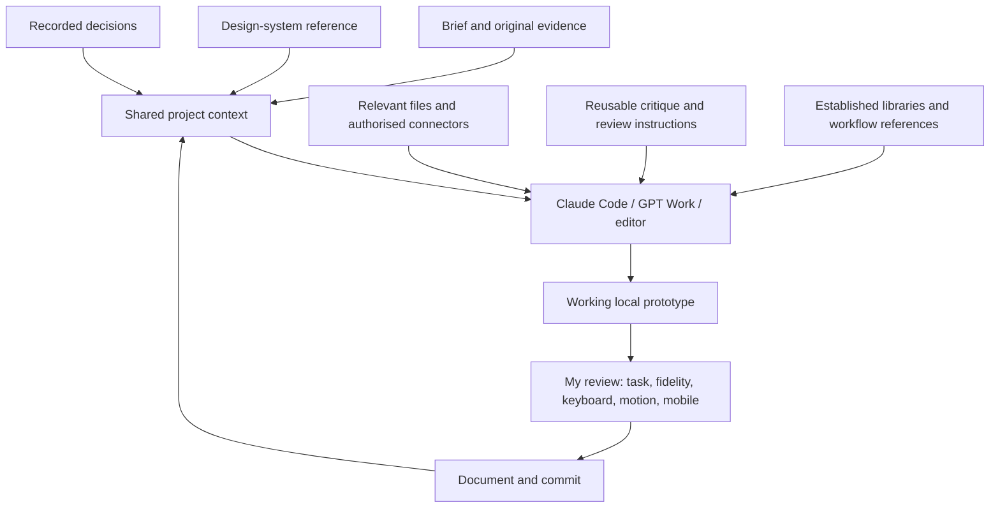

# How I use AI in design

## 1. I define the task and provide evidence

I start with the audience, task and constraints in [the brief](brief.md). I keep original screenshots and captions close to the case-study content so an AI-generated interpretation cannot silently become a claim about delivered work.

## 2. I use one shared design reference

[The design-system reference](design-system/README.md) points to the actual CSS tokens, components and accessibility rules. I give the same brief and reference to Claude Code, Codex or another working environment. The environment can change; the agreed design direction stays explicit.

## 3. I build on existing work

Three.js is the bundled 3D library used for Nevis. I explore Impeccable, Superpowers, Dream Loop and OpenDesign as references for critique, repeatable implementation and ambitious visual exploration. They are linked from the site; they are not installed dependencies or evidence that I used them on the original client work.

I choose connectors for the current task and the information I am authorised to use. The diagram describes a way of working, not a list of connected services installed in this repository.

## 4. I review the result and keep the decision

I inspect the interaction, compare it with the source, try keyboard and reduced-motion use, and check small screens. Automated checks cover defined behaviours. I document meaningful tradeoffs in [decisions](decisions.md) and distinguish observed verification from assumptions in [validation](validation.md).

AI assistance accelerates implementation; it does not establish authorship of client work, validate a medical idea or supply missing outcomes.
